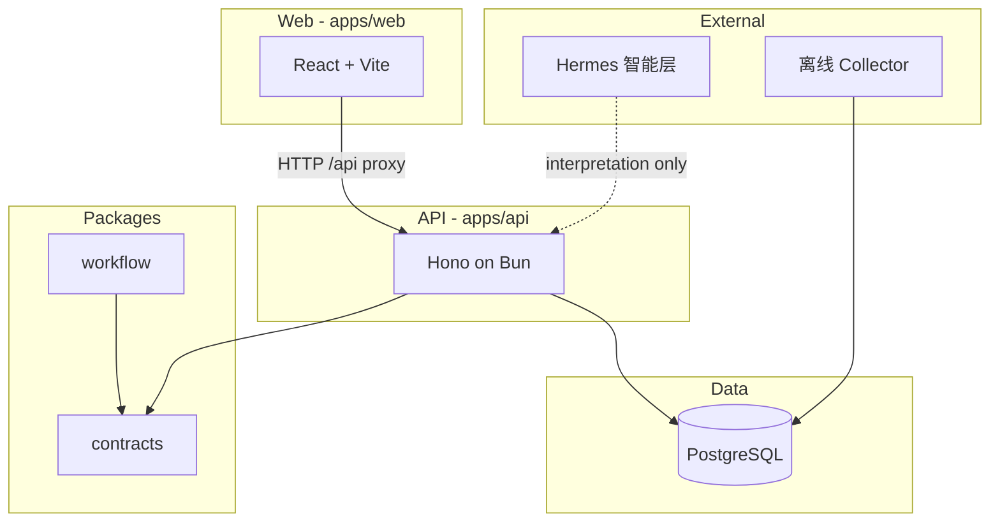

# 系统架构概览

## 逻辑分层

## 当前运行时

- **Web**：静态构建由合并进程提供；开发时代理 `/api/*`。端口、测试环境映射和路由清单见 [ui-backend-contract-audit.md](./ui-backend-contract-audit.md)。
- **API**：`GET /health` 与 `GET /api/health` 返回 `@studio/contracts` 定义的 JSON。商单、监控、导入和静态资源路由以该审计的清单为准。
- **PostgreSQL**：Compose 中的 `postgres` 服务已接入 API 与 Collector。监控迁移为 `packages/db/migrations/001`–`005`；商单域见 [commercial-db.md](./commercial-db.md)。离线采集见 [monitor-collector.md](./monitor-collector.md)。

## WP-000 当时的范围

WP-000 只交付健康检查和仓库骨架。上图描述的是当前仓库，不再把数据库画成未来依赖。

## 仓库约定

- 共享类型与校验放在 `packages/contracts`。
- 无 I/O 的工作流规则放在 `packages/workflow` 纯函数中，便于单测。
- 智能解析、LLM、关键词语义库**不属于**本仓库。
