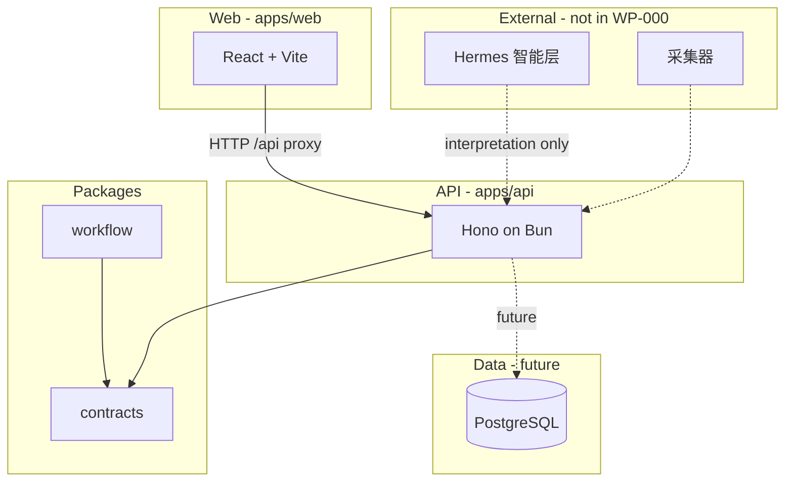

# 系统架构概览

## 逻辑分层

## WP-000 运行时

- **Web**：静态构建 + 开发时代理 `/api/*` 到 `localhost:3000`。
- **API**：`GET /health` 返回 `@studio/contracts` 定义的 JSON。
- **PostgreSQL**：Compose 服务已定义。监控迁移为 `packages/db/migrations/001`–`003`；商单域、只读 API 与流程写入见 [commercial-db.md](./commercial-db.md)。

## 仓库约定

- 共享类型与校验放在 `packages/contracts`。
- 无 I/O 的工作流规则放在 `packages/workflow` 纯函数中，便于单测。
- 智能解析、LLM、关键词语义库**不属于**本仓库。
